<p align="center">
  <a href="https://github.com/yunyicheng">
    
  </a>
</p>

<p align="center">
  <a href="https://yunyicheng.github.io"></a>
  <a href="https://linkedin.com/in/yunyi-cheng"></a>
  
</p>

<p align="center">
  >> me = Yunyi() — UserWarning: AllergenExposure: living with 2 cats anyway" width="100%" />
</p>

### `$ ls ~/stack`

| path | contents |
| :-- | :-- |
| `ml/` |  |
| `data/` |    |
| `apps/` |  |
| `sys/` |  |

### `$ git log --graph --all | snake`

<picture>
  <source media="(prefers-color-scheme: dark)" srcset="https://raw.githubusercontent.com/yunyicheng/yunyicheng/output/github-snake-dark.svg" />
  <source media="(prefers-color-scheme: light)" srcset="https://raw.githubusercontent.com/yunyicheng/yunyicheng/output/github-snake.svg" />
  
</picture>

### `$ cat easter_egg.fasta`

```text
>yunyi|cds|translate_me
ATGGAGTGGCATGCTGTGGAAGCCAACATCTGCGAGGATGCTTACTAA
```

<details>
<summary><code>hint: ATG = start, TAA = stop</code></summary>

```console
$ python -c "from Bio.Seq import Seq; print(Seq('ATGGAGTGGCATGCTGTGGAAGCCAACATCTGCGAGGATGCTTACTAA').translate())"
MEWHAVEANICEDAY*
```

</details>
